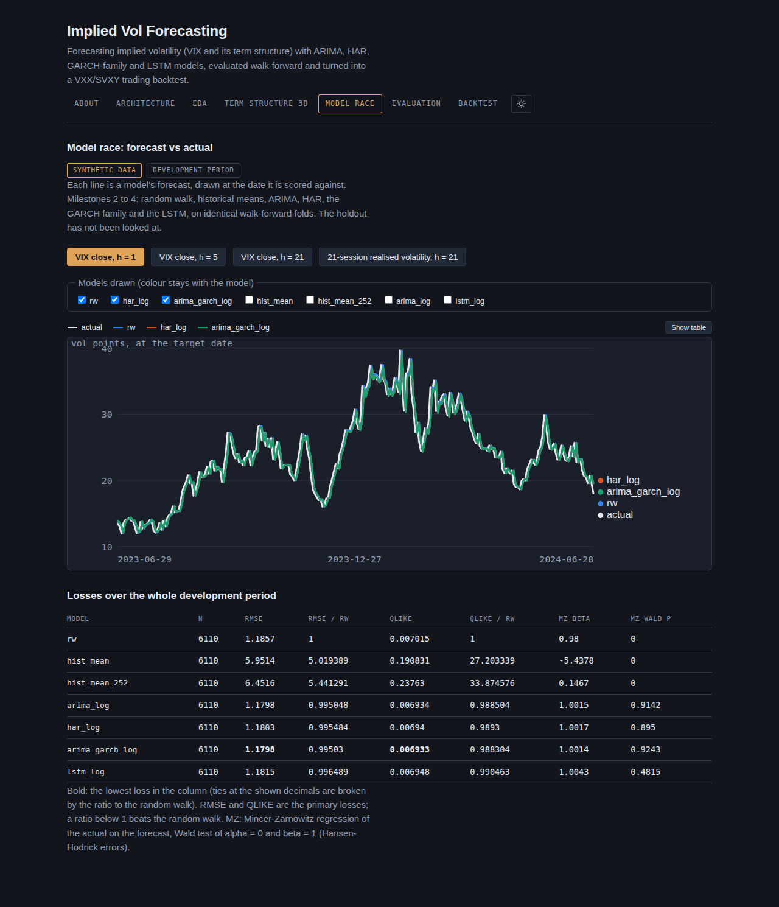
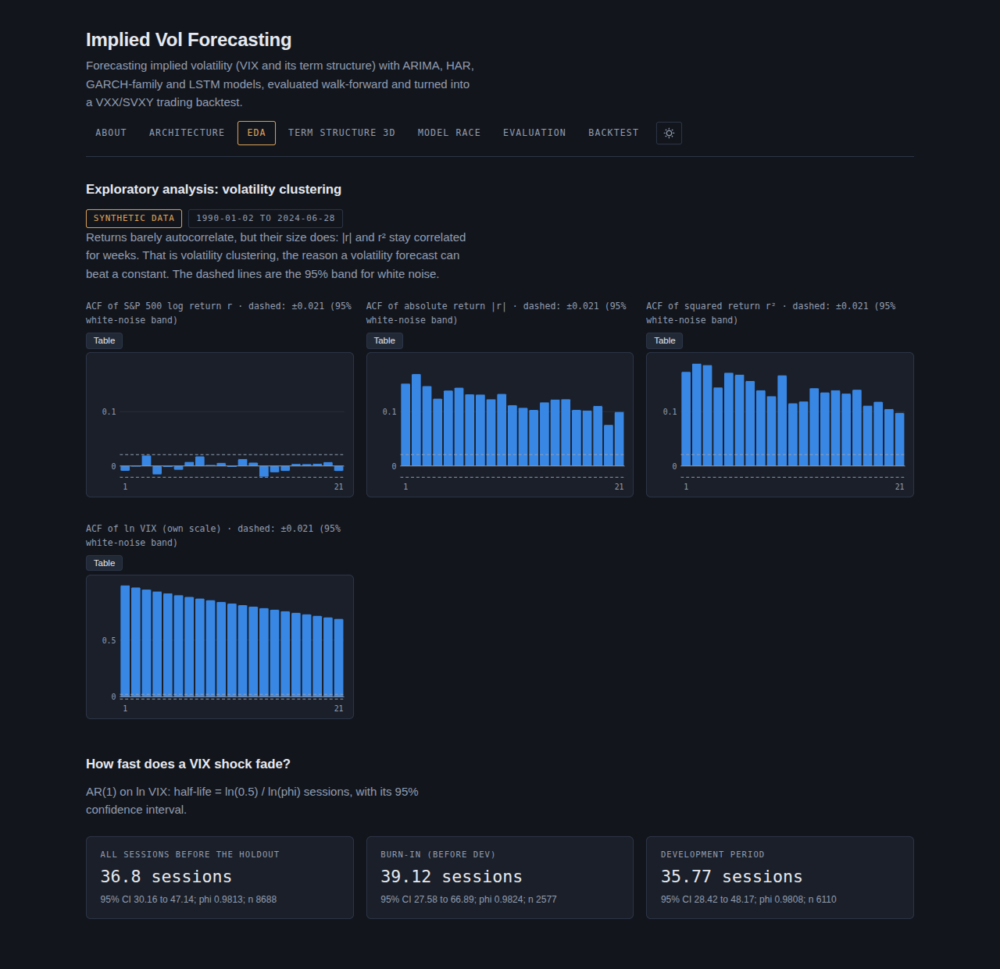
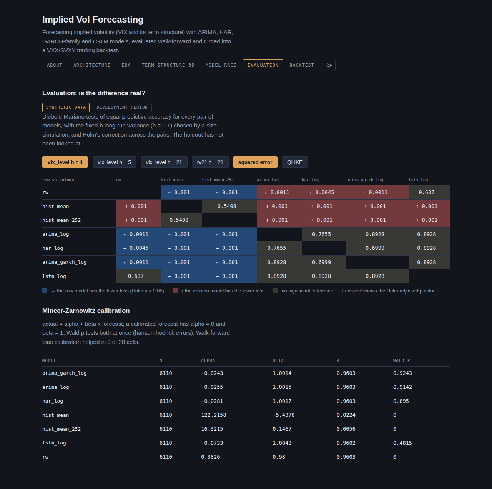
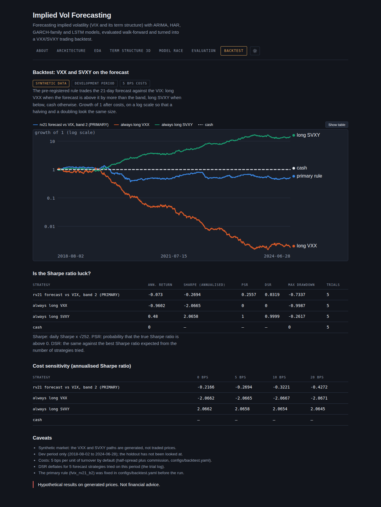
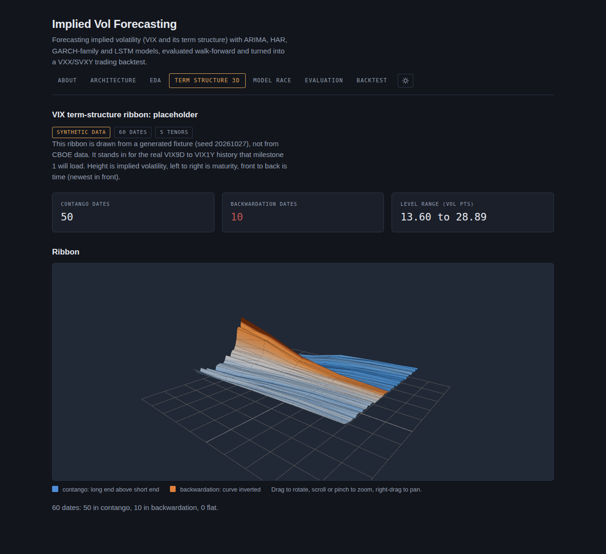
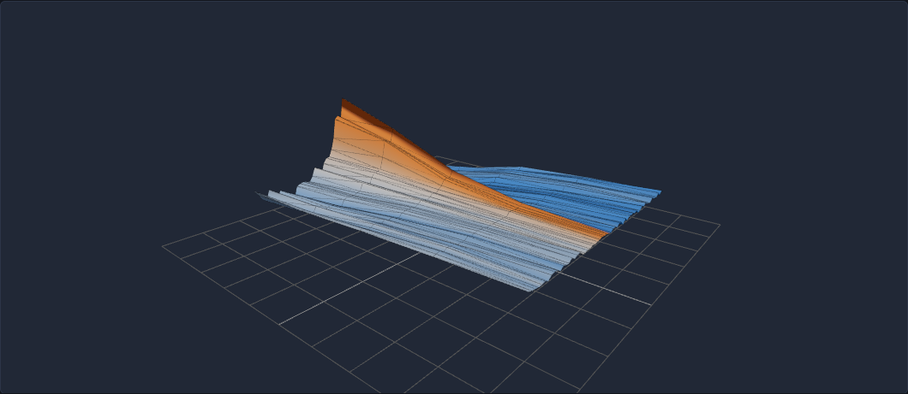

# implied-vol-forecasting

Forecast implied volatility (the VIX first) with a random walk, historical means, ARIMA, HAR, the GARCH family and an LSTM on identical walk-forward folds; test whether the differences are real (Diebold-Mariano with Holm's correction, Mincer-Zarnowitz); and backtest the forecasts on VXX and SVXY with the Probabilistic and Deflated Sharpe ratios. Python computes, a versioned JSON contract carries the results, and a React app draws them.

> **Status: milestones 0 to 6 done (code at `7eeae14`), plus this final polish.** Every milestone runs on real data locally and on seeded synthetic data in the tests. **The single guarded look at the holdout has not been taken** (see [The holdout look](#the-holdout-look-not-yet-taken)). Under the current data policy, real results are measured locally and are not published; every number and image below is from **synthetic** data.



## What it does, and what it teaches

The original brief: compare models that forecast implied volatility (ARIMA, GARCH and machine learning such as an LSTM), start with an exploratory analysis of volatility clustering and persistence, evaluate with RMSE, MAE and MAPE, and backtest trading strategies driven by the forecasts. Each milestone has a walkthrough in [`docs/milestones/`](docs/milestones/) and a queued checkpoint in [`LEARNING_LOG.md`](LEARNING_LOG.md).

| Milestone | What it adds | Walkthrough |
|---|---|---|
| 0 | Design, ADRs, the JSON contract, the app shell | [00](docs/milestones/00-scaffold-and-design.md) |
| 1 | Data pipeline (raw store, interim tables, calendar, gap check) and EDA: clustering, AR(1) half-life, unit roots, IV-RV spread, vol-of-vol | [01](docs/milestones/01-data-and-eda.md) |
| 2 | Baselines: random walk, historical means, ARIMA on ln VIX (d = 0), HAR | [02](docs/milestones/02-baselines.md) |
| 3 | GARCH, GJR and EGARCH on S&P 500 returns for `rv21`; ARIMA-GARCH on ln VIX | [03](docs/milestones/03-garch-done-right.md) |
| 4 | An LSTM (PyTorch, five seeds) on the same folds and rows | [04](docs/milestones/04-lstm.md) |
| 5 | Losses by horizon and regime, DM (fixed-b primary, Holm), MZ (Hansen-Hodrick), bias calibration | [05](docs/milestones/05-evaluation.md) |
| 6 | Pre-registered VXX/SVXY rule with costs, PSR and DSR, and the guarded holdout path | [06](docs/milestones/06-backtest.md) |

RMSE and QLIKE are the primary losses. MAE and MAPE are reported because the brief asks for them, but they are not consistent for a mean forecast (MAE favours the median, MAPE favours low forecasts).

## Screenshots

All screenshots show **synthetic data** with a visible SYNTHETIC DATA badge. They are made by `tools/screenshots.py` (Playwright and headless Chromium against `vite preview` on 127.0.0.1; every other host is blocked). Light theme versions are the `-corporate.png` files beside each one in [`docs/images/`](docs/images/).

| | |
|---|---|
|  |  |
| EDA: ACF of r, abs(r), r² and ln VIX; AR(1) half-life | Evaluation: DM matrix (fixed-b, Holm) and Mincer-Zarnowitz |
|  |  |
| Backtest: primary rule against always-long VXX, always-long SVXY and cash | Term structure: the three.js ribbon (synthetic fixture) |

**Hero image.** Blender hero renders: not rendered: Blender unreachable. The hero still is a three.js frame of the term-structure ribbon instead: [`docs/images/hero-ribbon-dark.png`](docs/images/hero-ribbon-dark.png) (and `hero-ribbon-corporate.png`).



## How to run each step

You need [uv](https://docs.astral.sh/uv/) 0.11 and Node 22. Data goes to `$VOL_DATA_DIR` (default `~/data/vol-projects`), never into the repository; every step refuses a data folder inside the checkout. Add `--synthetic` (before the subcommand) to run the same code on the seeded synthetic market under `$VOL_DATA_DIR/implied-vol-forecasting/synthetic/`.

```bash
uv sync                                              # Python 3.12, CPU-only torch (ADR 0002)
uv run pytest -q                                     # the Python tests (no network)

# 1. Data and EDA (milestone 1)
uv run python -m ivf.data fetch                      # Cboe CSVs and ^GSPC (network), SHA-256-named raw store
uv run python -m ivf.data build-interim              # typed, de-duplicated parquet
uv run python -m ivf.data check                      # calendar, gap check, the data_end freeze
uv run python -m ivf.data eda                        # features, targets, the local EDA report

# 2. Models on the development period (milestones 2 to 4)
uv run python -m ivf.models baselines
uv run python -m ivf.models garch
uv run python -m ivf.models lstm

# 3. Evaluation (milestone 5): losses, DM, MZ, regimes, calibration
uv run python -m ivf.evaluation report

# 4. Backtest (milestone 6), development period
uv run python -m ivf.data fetch --symbols VXX SVXY
uv run python -m ivf.backtest prepare
uv run python -m ivf.backtest run

# 5. The app
uv run python tools/export_app_data.py --mode synthetic          # app/public/data/synthetic/ from the synthetic store
uv run python tools/export_app_data.py --mode synthetic --check  # the committed files match a fresh export
uv run python tools/export_app_data.py --mode real               # real JSON, written outside the repo only
cd app && npm ci && npm run verify                               # lint, tests, coverage, build, deploy guard
npm run dev                                                      # local dev server
```

The synthetic run of steps 1 to 4 is the same commands with `--synthetic` (for example `uv run python -m ivf.models --synthetic garch`), and one command chains all ten of them: `uv run python tools/build_synthetic_store.py` (`--dry-run` lists them). It has not been timed end to end; the baselines step alone took 1,318 s in the polish review, and the model steps dominate. Run it at a clean commit if the exported JSON is to be committed, because the store's run id hashes the commit. The app ships the synthetic files only. `--mode real` writes the manifest and the term structure to `$VOL_DATA_DIR/implied-vol-forecasting/app-data/real/`; the result builders (`src/ivf/app_results.py`) take any data layout, and wiring them into real mode is left for the owner's data-policy decision.

## The holdout look (not yet taken)

The holdout starts on 2024-07-01 (ADR 0001 4.6) and contains the August 2024 and April 2025 volatility spikes. Every step above reads the development period only. The holdout is read **once**, by the owner, with one command:

```bash
uv run python -m ivf.backtest run --period holdout --preflight-only   # checks every precondition, writes nothing
uv run python -m ivf.backtest run --period holdout --one-look         # THE look (real data)
```

The look is guarded. A preflight runs before anything is written: the tree must be clean and pushed, no look record may exist, `holdout_looks` must match the config, the tradable segments must cover the window, and the model choice and inputs must load. A failed preflight leaves no record. Then `ROOT/backtest/holdout_look.json` is created create-only, so a second look finds it and stops. From that point the look is spent, whatever happens next: the frozen models forecast the holdout, milestone 5's report runs on it (DM and MZ descriptive only), and the backtest applies the pre-registered rule and its pre-registered verdict. `--resume` continues a look that failed at a stage, and only with the same commit, protocol, config and inputs. On synthetic data the identical path runs in the tests. **On real data it has not been run** (`holdout_looks: 0`).

## Results (synthetic data only)

Real results are measured locally and are not published under the current data policy (ADR 0001 D2, strict: no real vendor values in tracked files; the owner's change is pending). The tables below are read from `app/public/data/synthetic/`, the JSON that `uv run python tools/export_app_data.py --mode synthetic` regenerates from the synthetic dev store (built by `tools/build_synthetic_store.py`); `--check` on the same command ties the files to the store. Every number is printed by `uv run python tools/results_table.py`, and `uv run python tools/results_table.py --check` fails if this block differs from what those files give.

<!-- results:begin -->
Synthetic data only (development period; the backtest runs 2018-08-02 to 2024-06-28). Produced by `uv run python tools/results_table.py`.

**RMSE relative to the random walk** (below 1 beats it; lowest in bold; ratios carry 6 decimals so near-ties are told apart):

| Model | VIX h=1 | VIX h=5 | VIX h=21 | rv21 h=21 |
|---|---:|---:|---:|---:|
| `rw` | 1.0 | 1.0 | 1.0 | 1.0 |
| `hist_mean` | 5.019389 | 2.291141 | 1.206408 |  |
| `hist_mean_252` | 5.441291 | 2.498725 | 1.343429 |  |
| `arima_log` | 0.995048 | 0.976248 | 0.909972 |  |
| `har_log` | 0.995484 | 0.97679 | 0.91263 |  |
| `har_rv` |  |  |  | 0.889032 |
| `vix_implied` |  |  |  | 1.992155 |
| `garch` |  |  |  | 0.883892 |
| `gjr` |  |  |  | 0.885318 |
| `egarch` |  |  |  | **0.882829** |
| `arima_garch_log` | **0.99503** | **0.97619** | **0.90955** |  |
| `lstm_log` | 0.996489 | 0.980383 | 0.920553 | 0.896785 |

**QLIKE relative to the random walk:**

| Model | VIX h=1 | VIX h=5 | VIX h=21 | rv21 h=21 |
|---|---:|---:|---:|---:|
| `rw` | 1.0 | 1.0 | 1.0 | 1.0 |
| `hist_mean` | 27.203339 | 5.544278 | 1.483895 |  |
| `hist_mean_252` | 33.874576 | 7.008527 | 1.993542 |  |
| `arima_log` | 0.988504 | 0.94417 | 0.80631 |  |
| `har_log` | 0.9893 | 0.946066 | 0.811896 |  |
| `har_rv` |  |  |  | 0.651239 |
| `vix_implied` |  |  |  | 1.858912 |
| `garch` |  |  |  | **0.645263** |
| `gjr` |  |  |  | 0.646624 |
| `egarch` |  |  |  | 0.653851 |
| `arima_garch_log` | **0.988304** | **0.943566** | **0.80444** |  |
| `lstm_log` | 0.990463 | 0.950451 | 0.825578 | 0.704175 |

- Diebold-Mariano (fixed_b, b = 0.1): 90 of 168 model pairs differ at Holm-adjusted p < 0.05.
- Walk-forward bias calibration helps in 0 of 28 cells.
- ln VIX half-life (AR(1), sessions before the holdout): 36.8 sessions (95% CI 30.16 to 47.14); ACF at lag 1: |r| 0.1519, r² 0.1736, r -0.009 (white-noise band ±0.021).

**Backtest at 5 bps** (growth of 1; Sharpe annualised as daily Sharpe × √252; PSR against Sharpe 0; DSR deflated for the trials):

| Strategy | Ann. return | Sharpe (annualised) | PSR | DSR | Max drawdown | Trials |
|---|---:|---:|---:|---:|---:|---:|
| rv21 forecast vs VIX, band 2 (PRIMARY) | -0.073 | -0.2694 | 0.2557 | 0.0319 | -0.7337 | 5 |
| always long VXX | -0.9602 | -2.0665 | 0.0 | 0.0 | -0.9987 | 5 |
| always long SVXY | 0.48 | 2.0658 | 1.0 | 0.9999 | -0.2617 | 5 |
| cash | 0.0 | n/a | n/a | n/a | 0.0 | 5 |

**Annualised Sharpe ratio by cost level** (bps per unit of turnover):

| Strategy | 0 bps | 5 bps | 10 bps | 20 bps |
|---|---:|---:|---:|---:|
| rv21 forecast vs VIX, band 2 (PRIMARY) | -0.2166 | -0.2694 | -0.3221 | -0.4272 |
| always long VXX | -2.0662 | -2.0665 | -2.0667 | -2.0671 |
| always long SVXY | 2.0662 | 2.0658 | 2.0654 | 2.0645 |
| cash | n/a | n/a | n/a | n/a |
<!-- results:end -->

What the synthetic run shows. Numbers marked "table above" come from `tools/results_table.py`; the others are not produced by it and are cited to the walkthrough section that measured them:

- **The random walk is hard to beat at h = 1**: the best model is 0.5% better in RMSE (table above: 0.99503). At h = 21 mean reversion pays: about 9% better (0.90955).
- **The LSTM loses to HAR** in every panel (table above), and each of its five seeds loses to HAR on its own ([milestone 4, "What review A found"](docs/milestones/04-lstm.md#what-review-a-found)).
- **ARIMA uses d = 0**: KPSS chose d = 1 on 24-76% of stationary AR(1) series as persistent as ln VIX, and forcing d = 1 raised h = 21 RMSE 17% (5.006 to 5.845). Both measured in [milestone 2, "What review A found"](docs/milestones/02-baselines.md#what-review-a-found), item 7, and the [M2 review A ledger](docs/validation/M2-review-A-baselines.md).
- **GARCH is within 1.2% of the truth floor** on synthetic `rv21`: QLIKE 0.1396 against 0.1379 for the true conditional variance, measured in [milestone 3, section 7.2](docs/milestones/03-garch-done-right.md#72-synthetic-data-publishable) (the truth floor is not in the app data).
- **Bias calibration helps in 0 of 28 cells** (table above; [milestone 5, section 7.4](docs/milestones/05-evaluation.md#74-synthetic-data-publishable)).
- **The primary trading rule does not survive deflation**: DSR 0.0319 and a negative annualised Sharpe ratio at every cost level, while always-long SVXY earns the roll yield that the synthetic VXX pays by construction (`src/ivf/backtest/data.py`) (table above; [milestone 6](docs/milestones/06-backtest.md)).

## Data and licensing

- **No vendor data is in this repository.** Cboe index history is licensed for personal, non-commercial use, and FRED's `*CLS` series and Yahoo Finance data carry the same kind of restriction. The pipeline downloads them to your own machine only.
- **Where data lives:** `$VOL_DATA_DIR/implied-vol-forecasting/`, outside the repo. `VOL_DATA_DIR` defaults to `~/data/vol-projects`.
- **No vendor series is published.** The goal is that nothing committed, git history included, lets anyone reconstruct a vendor index's daily series or a material part of it. Per-date forecasts, errors and equity curves count as the data, because the random walk's cumulative one-day errors rebuild the VIX path. They are never committed for real data.
- **One release of real results, at most, and only unitless numbers.** `reports/*.agg.csv` may hold a single set of real result tables, written once for a frozen end date. Every number in it is a ratio to the random walk, a test statistic, a pass/fail flag, a count or a time span, for a whole period (development or holdout). Never a level in vol points, a mean, a coefficient, a return, a drawdown or a regime cell. A model is included only if its numbers do not change when the VIX is rescaled, even given the public S&P 500 series; models tied to the S&P 500 (for example uncalibrated GARCH on the VIX level) stay on your machine. A wrong value is withdrawn, never corrected. An earlier promise that no single day is recoverable was deleted, because each new combination of published statistics broke it ([milestone 0, section 7](docs/milestones/00-scaffold-and-design.md#7-what-the-adversarial-reviews-found-and-what-changed)). The probes that test this run on simulated data and live in [`tools/licensing/`](tools/licensing/README.md).
- **The app ships a synthetic fixture,** generated from a seed and labelled synthetic wherever it is drawn. Real-data JSON is written outside the repo and served only by the local dev server.
- The reasoning and the guards are in [ADR 0001](docs/adr/0001-python-core-versioned-json-app.md), decision D2 (the closed publication set, rules R1 and Q). That is a technical rule, not legal advice, and D2 is still Proposed until the author accepts it, with open items O8 to O10 (scale-tied rows, "material part", the LSTM).

## Repo layout

```
README.md  LEARNING_LOG.md  LICENSE  pyproject.toml  uv.lock
src/ivf/          the Python package; all computation lives here
                  data/ features/ models/ evaluation/ backtest/; app_results.py (the result views' JSON)
configs/          protocol.yaml, protocol.synthetic.yaml, models.yaml, backtest.yaml, iv_indices.yaml, instruments.yaml
tests/            pytest, with hand-worked expected values; no network
notebooks/        generated from tools/build_notebooks.py, never hand-edited
tools/            export_app_data.py, results_table.py, screenshots.py, build_notebooks.py, bench_lstm.py,
                  diagrams/, licensing/ (probes of the publication rule, simulated data only), probes/
schemas/app-data/ the JSON Schemas of the Python-to-app contract (schema 1.1.0)
app/              React 19 + TypeScript + Vite + three.js: About, Architecture, EDA, Term structure 3D,
                  Model race, Evaluation, Backtest; public/data/synthetic/ holds the committed JSON
docs/             prfaq.md, adr/, architecture/, concepts/, milestones/, validation/, images/
```

## Documentation

| What | Where |
|---|---|
| The idea, written backwards from the finished project | [`docs/prfaq.md`](docs/prfaq.md) (PR/FAQ) |
| Why the design is the way it is | [ADR 0001](docs/adr/0001-python-core-versioned-json-app.md): Python core, JSON contract, licensing, storage, evaluation protocol, determinism. [ADR 0002](docs/adr/0002-compute-and-numeric-stack.md): compute and numeric stack. |
| Stored tables and JSON files | [`docs/architecture/data-model.md`](docs/architecture/data-model.md) |
| Diagrams | [`docs/architecture/`](docs/architecture/README.md), with Mermaid sources [`architecture.mmd`](docs/architecture/architecture.mmd), [`erd.mmd`](docs/architecture/erd.mmd), [`data-flow.mmd`](docs/architecture/data-flow.mmd), [`process.mmd`](docs/architecture/process.mmd) and [`walk-forward-sequence.mmd`](docs/architecture/walk-forward-sequence.mmd). The system architecture is also embedded as a rendered diagram in that folder's README. |
| Theory behind each idea | [`docs/concepts/`](docs/concepts/): [00 background](docs/concepts/00-background.md), [01 forecast targets and annualisation](docs/concepts/01-forecast-targets-and-annualisation.md), [02 walk-forward evaluation and look-ahead](docs/concepts/02-walk-forward-evaluation-and-look-ahead.md), [03 reproducibility and data contracts](docs/concepts/03-reproducibility-and-data-contracts.md) |
| Milestone walkthroughs | [`docs/milestones/`](docs/milestones/), starting with [milestone 0](docs/milestones/00-scaffold-and-design.md) |
| Adversarial reviews and what they found | [`docs/validation/`](docs/validation/): [review A, code and numerics](docs/validation/M0-review-A-code-numerics.md); [review B, maths and documents](docs/validation/M0-review-B-maths-docs.md); [review C, the literature brief](docs/validation/M0-review-C-background.md); [review D, the fixes for A and B](docs/validation/M0-review-D-fixes.md); [review E, the final attack](docs/validation/M0-review-E-final.md) |
| The course index: milestones, questions, answers | [`LEARNING_LOG.md`](LEARNING_LOG.md) |

## Not financial advice

This is a research and learning project. Nothing here is a recommendation or an offer to trade. Backtests are hypothetical, past performance does not predict future results, and volatility exchange-traded products can lose most of their value in a day.

## License

[MIT](LICENSE), copyright 2026 Rajib Bahar. The licence covers this repository's code and documents. It does not cover Cboe, FRED or Yahoo data, which this repository does not contain.

## Credits

- **Cboe index data** is used through Cboe's site under Cboe's terms (personal, non-commercial use) and is not redistributed here. Cboe and VIX are trademarks of Cboe Exchange, Inc. This project is independent and is not affiliated with, endorsed by or sponsored by Cboe.
- **FRED** (Federal Reserve Bank of St. Louis) is the fallback source for the same index series, and **Yahoo Finance**, through the `yfinance` library, supplies underlying and ETP prices. Both are used for personal research only.
- **`sharpe-observatory`**: the Probabilistic and Deflated Sharpe ratio code (`scripts/metrics.py`) is reused from the author's own repository under its MIT licence (milestone 6, `src/ivf/backtest/sharpe.py`).
- **Methods**: HAR is Corsi (2009); QLIKE as a robust loss is Patton (2011); the Diebold-Mariano and Mincer-Zarnowitz tests are the standard forecast-comparison tools.
- **Libraries**: statsmodels, arch, pmdarima, PyTorch, pandas, numpy, scipy, React, three.js and React Three Fiber.
