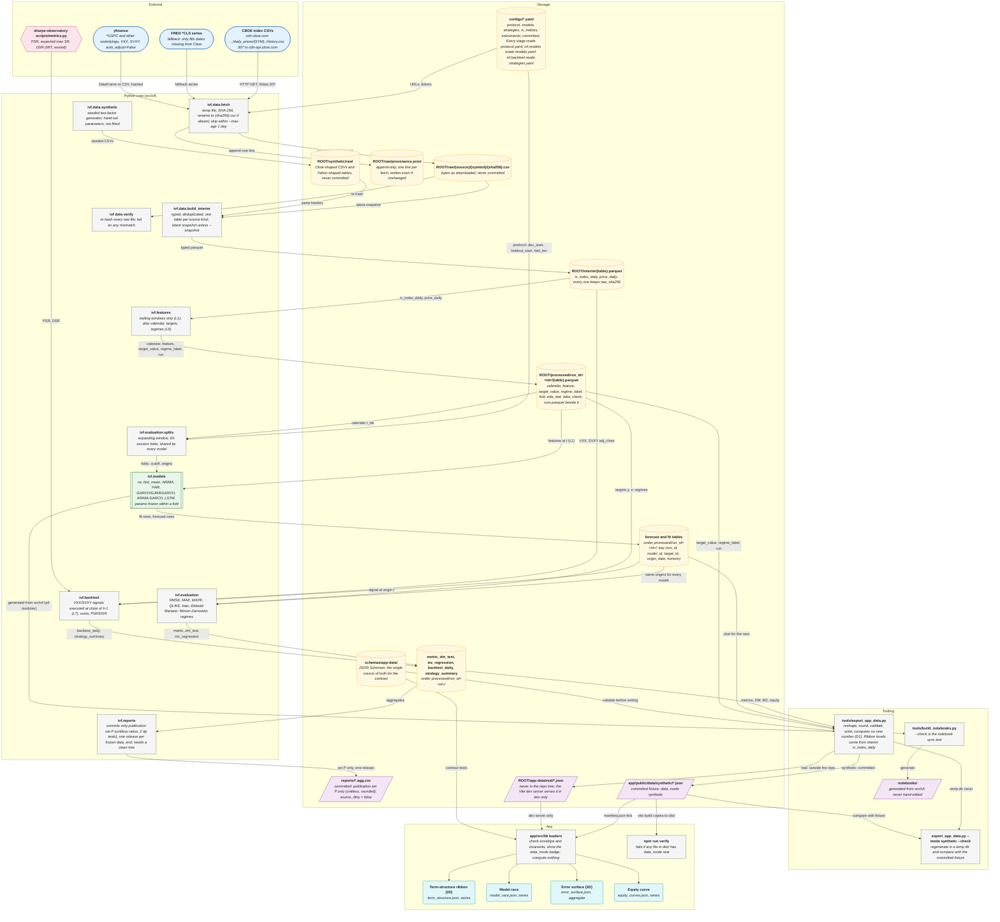

# Architecture diagrams

The decisions behind these diagrams are in
[ADR 0001](../adr/0001-python-core-versioned-json-app.md). The stored tables and JSON files are
described in [`data-model.md`](data-model.md). Each diagram has a YAML spec in [`specs/`](specs/)
(the source of truth). The vendored diagram toolkit in [`tools/diagrams/`](../../tools/diagrams/)
renders every spec into [`out/`](out/): Mermaid (`.mmd`), SVG, PNG, draw.io and Lucid files.

**`out/` is now the rendered source.** The `.mmd` files at the top level of this folder
(`architecture.mmd`, `data-flow.mmd`, `erd.mmd`, `process.mmd`, `walk-forward-sequence.mmd`) are the
M0 hand-kept copies. They stay until `out/` has been reviewed, then they are removed. They are no
longer kept in sync with the specs.

## Index

| Diagram | Spec | Rendered (`out/`) | What it shows |
|---|---|---|---|
| Data model (ERD) | [`specs/erd.yaml`](specs/erd.yaml) | [`erd.mmd`](out/erd.mmd), [`erd.svg`](out/erd.svg) | Every stored table and app JSON file, with keys and cardinalities |
| System architecture | [`specs/architecture.yaml`](specs/architecture.yaml) | [`architecture.mmd`](out/architecture.mmd), [`architecture.svg`](out/architecture.svg) | End to end: external sources, the Python core (`src/ivf`), storage, tooling and the app, with the synthetic JSON (committed) kept apart from the real JSON (outside the repo) |
| Data flow | [`specs/data_flow.yaml`](specs/data_flow.yaml) | [`data_flow.mmd`](out/data_flow.mmd), [`data_flow.svg`](out/data_flow.svg) | One datum, from a CBOE CSV row to a JSON column array. Each edge names the transformation and the no-look-ahead rule (L1 to L7) that applies |
| Milestone process | [`specs/process.yaml`](specs/process.yaml) | [`process.mmd`](out/process.mmd), [`process.svg`](out/process.svg) | Build, checks, learning material, adversarial review, number re-measurement, security review, push, then the pause for the learner |
| Walk-forward fold | [`specs/walk_forward_sequence.yaml`](specs/walk_forward_sequence.yaml) | [`walk_forward_sequence.mmd`](out/walk_forward_sequence.mmd), [`walk_forward_sequence.svg`](out/walk_forward_sequence.svg) | One fold in order: splitter, feature builder, scaler fit on train only, model fit on pairs with target date at or before the cutoff, frozen parameters, daily forecasts, evaluator, loss rows |

## System architecture, rendered inline

GitHub renders Mermaid inside a fenced block in a Markdown file. The block below is a copy of the
M0 hand-kept [`architecture.mmd`](architecture.mmd), not of
[`out/architecture.mmd`](out/architecture.mmd), and it goes when that file does. The diagram is
large, so open it full width.



## How to render

Every `.mmd` file renders with Mermaid CLI (needs Node and a Chromium for Mermaid CLI to drive):

```bash
npx -y @mermaid-js/mermaid-cli@11.17.0 -i docs/architecture/out/architecture.mmd -o /tmp/architecture.svg
```

If Mermaid CLI cannot find its bundled Chromium, pass `-p puppeteer.json`, where that file holds
`{"executablePath": "<path to a local Chromium>", "args": ["--no-sandbox"]}`. Use `-o x.png -w 2200`
for a PNG. The architecture diagram is large, so open the SVG and zoom rather than reading a thumbnail.

## Rebuild and check `out/`

`out/` is generated; do not edit it by hand. After changing a spec, from the repo root:

```bash
uv run --group diagrams python tools/diagrams/build.py docs/architecture/specs --out docs/architecture/out
uv run --group diagrams python tools/diagrams/build.py docs/architecture/specs --out docs/architecture/out --check --no-png
uv run --group diagrams --with playwright==1.64.1 python tools/diagrams/build.py docs/architecture/specs --verify-mermaid
```

The second line is what `tests/test_diagrams.py` runs. `--no-png` because PNG bytes are verified
on aarch64 only. The third line is the Mermaid render gate: it draws every `.mmd` with Mermaid
12.2.0 (the version GitHub's Markdown viewer used on 2026-10-28) and checks that each label shows as written. It needs the
Mermaid bundle in `~/.cache/diagram-kit` and a Chromium, set up as in the kit's README
("Checking Mermaid before a commit"); run it before every commit that changes a spec. The kit
refuses to overwrite a file it did not write (exit 2), so keep hand-made files out of `out/`.

SVG, PNG and draw.io files come from the same layout as the Mermaid files. Import into Figma,
FigJam and Lucidchart is untested (import-tested: no). See
[`tools/diagrams/VENDORED.md`](../../tools/diagrams/VENDORED.md) for the kit version.

## Spec format

The three flow specs share one shape, the vendored kit's schema (`SCHEMA.md` in
https://github.com/rajib2k5/vol-diagram-kit). The ERD and the walk-forward sequence use the kit's
`erd` and `sequence` kinds. The file name is the output name, so it is an identifier too:
`data_flow.yaml`, not `data-flow.yaml`.

```yaml
kind: flow
title: ...
direction: LR | TB
lanes: [{id, label}]
nodes: [{id, label, lane, type, sublabel?}]
edges: [{from, to, label}]
```

| `type` | Meaning | Mermaid shape |
|---|---|---|
| `source` | Data we do not own | Stadium |
| `external` | Code or a person outside the loop | Hexagon |
| `process` | Code or a step that runs | Rectangle |
| `model` | A fitted forecaster | Subroutine |
| `store` | A persistent table or file | Cylinder |
| `output` | A row, cell, array or committed product | Parallelogram |
| `ui` | What the learner sees | Rounded box |

There is no diamond: a decision is a `process` node whose label ends in `?` and whose exits are
labelled. Ids match `[A-Za-z_][A-Za-z0-9_]*` and are not words Mermaid cannot take. Labels and
sublabels are one line, with no wrapping, so a long sublabel makes a wide card. Each lane becomes
one `subgraph`.

When you change a spec, rebuild `out/` (above) and commit both in the same commit. The top-level
`.mmd` files are not touched.

## Reading the data-flow diagram

| Rule | Meaning (ADR 0001, 4.7) |
|---|---|
| L1 | Features use trailing windows only. The information set at origin t is data dated at or before t. |
| L2 | A training pair is usable only if its target date is at or before the cutoff. |
| L3 | Scalers, imputers and clipping thresholds are fitted on the training rows only, at each cutoff. |
| L4 | The LSTM's early-stopping block is the last 252 training origins, separated by an h-session purge. |
| L5 | Regimes come from data at or before their date, with fixed thresholds. |
| L6 | Hyper-parameters are chosen on dev rows whose target date is before `holdout_start`. |
| L7 | A signal at origin t is executed at the close of t+1. |

## Where the diagrams go beyond ADR 0001

These are choices made while drawing, to confirm when the code lands:
- ADR 0001 names `ivf.data.fetch`, `ivf.data.build_interim`, `ivf.data.synthetic`, `ivf.reports`,
  `ivf data verify` and `tools/export_app_data.py`. The names `ivf.features`,
  `ivf.evaluation.splits`, `ivf.models`, `ivf.evaluation`, `ivf.backtest`, `tools/build_notebooks.py`
  and `notebooks/` come from the project plan and brief.
- ADR D3 says only "the pipeline stages" write the calendar, `target_value` and `regime_label`
  tables, so the architecture diagram draws them inside `ivf.features`.
- The "loss row" in the data-flow diagram has no table in the data model. It is drawn as a transient
  state inside `ivf.evaluation`.

## What the kit's schema could not carry

Where a spec keeps the meaning in a comment, `out/` does not show it:
- **Decision diamonds.** `pair_ok` and `n_check` (data flow) and `refuted` and `first_push`
  (process) are rectangles. Their labels end in `?` and their exits say yes or no.
- **ERD: every foreign key is an edge.** `out/erd.mmd` has 76 relations: the 55 of the M0 spec plus
  21 for foreign-key columns the M0 spec declared but did not draw (the `run_id` keys and the other
  parts of composite keys).
- **ERD: the parent end.** The kit draws it from the child column only: exactly one when the column
  is NOT NULL, zero or one when it is nullable. The M0 spec's left-hand multiplicity does not
  show for 13 relations (`target_value` to `forecast`, `forecast` to `metric`, `price_daily` to
  `backtest_daily` and ten table-to-JSON relations); the `# was ... "L:R"` comment beside each in
  `specs/erd.yaml` has the old pair.
- **ERD: relations without a foreign key.** 16 M0 relations (the table-to-JSON lineage, the four
  `lists` edges from `manifest.json`, `forecast` to `metric`, `price_daily` to `backtest_daily`)
  have no key column. The kit needs a column at each end, so `specs/erd.yaml` picks one; the line
  attaches there and means no more than the label.
- **ERD: dotted column names** (`panels.series`, `surfaces.values`) became `panels_series` and
  `surfaces_values`. The per-entity `store` (yaml, parquet, json, ...) is a comment, not drawn.
- **Walk-forward sequence.** The five notes were over one or two lifelines. The kit hangs a note on
  a message, to the right of that message's target lifeline, so each is attached to the nearest
  message. Participant labels and notes are one line, so the `<br/>` breaks became spaces.
- **Wide flows.** Nothing wraps, so `architecture.svg` is 6,924 px wide and 3,024 px high.
